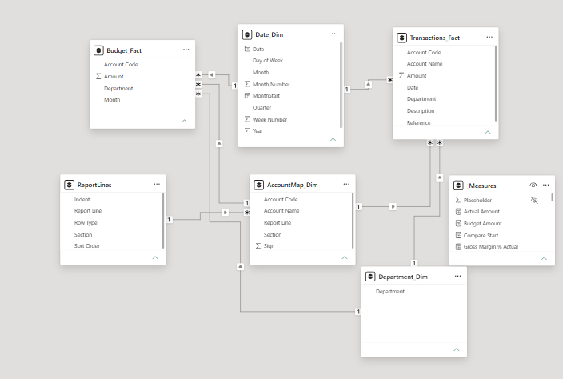
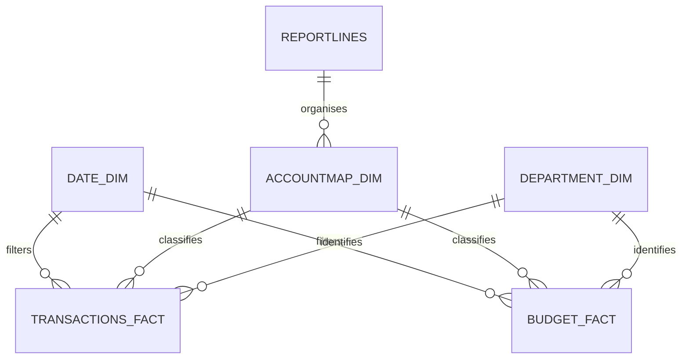
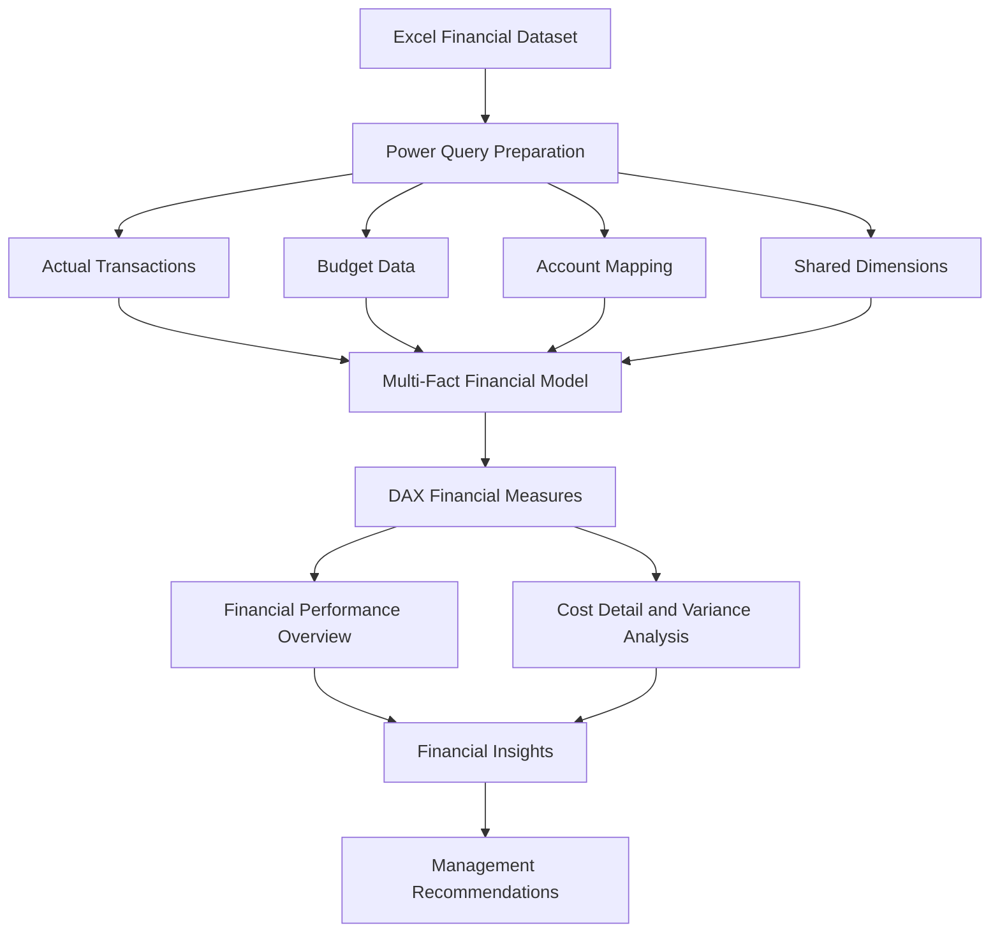

# Budget vs Actuals & Rolling Forecast | Microsoft Power BI


## Project Overview

This project presents an interactive financial performance reporting solution developed using Microsoft Power BI.

The analysis focuses on budget versus actual performance, revenue, gross profit, operating expenses, net profit, departmental cost variances and historical financial comparisons.

The project combines a multi-fact relational data model, account mapping, financial reporting hierarchies, DAX calculations and time intelligence to transform financial records into meaningful management information.

The objective is to support financial planning and analysis (FP&A), budget monitoring, expenditure control, forecasting discussions and informed management decision-making.

## Dashboard Previews

### Page 1 — Financial Performance Overview

.png)

### Page 2 — Cost Detail and Variance Analysis

.png)

## Executive Summary

| Financial KPI | Displayed Result |
|---|---:|
| Year-to-Date Actual Revenue | $2M |
| Year-to-Date Actual Gross Profit | $868K |
| Year-to-Date Gross Profit Margin | 48.1% |
| Year-to-Date Actual Operating Expenses | $780K |
| Year-to-Date Actual Net Profit | $43K |
| Overall Cost Variance — June 2026 | 30.1% |
| Overall Cost Variance — September 2026 | 8.0% |
| Production Cost Variance — June 2026 | 46.2% |
| Marketing Cost Variance — July 2026 | 29.8% |

These figures are taken directly from the supplied dashboard screenshots.

Headline monetary KPIs use rounded Power BI display units. The underlying exact values may differ from the rounded figures shown.

The analysis identifies significant variation in departmental costs and highlights ingredients as the largest displayed cost variance by account.

The report also demonstrates the importance of evaluating revenue, costs and profitability together rather than relying solely on sales performance.

## Business Problem

Organisations require reliable financial reporting to understand whether actual financial performance aligns with approved budgets and anticipated financial outcomes.

Without consolidated financial analysis, management may struggle to:

- Monitor revenue and profitability.
- Identify material budget variances.
- Understand the drivers of financial performance.
- Investigate unexpected expenditure increases.
- Compare performance across departments.
- Evaluate historical financial trends.
- Develop reliable forecasting processes.
- Identify potential risks to profitability.
- Communicate financial performance to business stakeholders.

This project addresses these requirements through an interactive Power BI financial reporting solution.

## Project Objectives

- Analyse actual revenue against financial budgets.
- Monitor gross profit and gross profit margin.
- Evaluate operating expenditure.
- Analyse net profit performance.
- Compare actual, budgeted and previous-year financial results.
- Identify the principal drivers of profit variance.
- Investigate material account-level expenditure differences.
- Compare departmental cost performance across reporting periods.
- Develop a structured multi-fact financial data model.
- Apply DAX calculations and time intelligence.
- Support forward-looking financial planning discussions.
- Translate analytical findings into potential business recommendations.

## Tools and Technologies

| Tool / Technique | Application |
|---|---|
| Microsoft Power BI Desktop | Interactive financial reporting |
| Microsoft Excel | Source financial data |
| Power Query | Data preparation and transformation |
| DAX | Financial calculations and reusable measures |
| Time Intelligence | YTD and previous-year comparisons |
| Multi-Fact Data Modelling | Connecting actual and budgeted financial information |
| Shared Dimensions | Consistent filtering across financial datasets |
| Account Mapping | Financial account classification |
| Reporting Hierarchies | Structured financial statement reporting |
| Financial Sign Conventions | Revenue and expense presentation |
| KPI Cards | Headline financial indicators |
| Line Charts | Financial trend analysis |
| Bar Charts | Financial variance comparisons |
| Matrix Visualisations | Departmental cost variance reporting |
| GitHub | Technical documentation and version control |

## Dataset Overview

The project uses an Excel-based financial dataset containing actual transactions, budget information, account classifications and supporting reporting structures.

The financial data model separates recorded transactions from budgeted financial amounts, allowing performance comparisons across shared analytical dimensions.

### Actual Transactions

| Field | Description |
|---|---|
| Account Code | Financial account identifier |
| Account Name | Financial account description |
| Amount | Recorded transaction amount |
| Date | Transaction reporting date |
| Department | Organisational department |
| Description | Supporting transaction information |
| Reference | Transaction reference |

### Budget Information

| Field | Description |
|---|---|
| Account Code | Financial account identifier |
| Amount | Budgeted financial amount |
| Department | Department associated with the budget |
| Month | Budget reporting period |

### Account Mapping

| Field | Description |
|---|---|
| Account Code | Financial account identifier |
| Account Name | Financial account description |
| Report Line | Associated financial reporting line |
| Section | Financial reporting classification |
| Sign | Financial reporting sign convention |

### Department Dimension

The department dimension supports consistent organisational filtering across actual and budgeted financial records.

The displayed report includes four departments:

- Administration
- Marketing
- Production
- Sales

### Financial Reporting Lines

| Field | Description |
|---|---|
| Report Line | Financial statement reporting line |
| Row Type | Reporting line classification |
| Section | Associated financial reporting section |
| Sort Order | Intended financial statement ordering |
| Indent | Supporting reporting hierarchy presentation |

These structures provide a foundation for organised financial reporting and consistent account classification.

## Data Model



The Power BI model contains seven visible tables, including two fact tables, shared analytical dimensions, supporting financial reporting lines and a centralised measures table.

### Model Structure

| Table | Function |
|---|---|
| Transactions_Fact | Recorded actual financial transactions |
| Budget_Fact | Planned financial amounts |
| Date_Dim | Calendar and time intelligence dimension |
| AccountMap_Dim | Financial account classification and mapping |
| Department_Dim | Organisational department dimension |
| ReportLines | Financial reporting line structure |
| Measures | Centralised DAX calculations |

### Multi-Fact Data Modelling

Unlike a reporting solution based on a single transactional table, this project incorporates separate tables for actual transactions and budgets.

The shared date, account and department dimensions provide consistent analytical context across the two financial datasets.

This modelling approach supports:

- Actual versus budget comparisons.
- Account-level financial analysis.
- Departmental variance reporting.
- Consistent date-based filtering.
- Financial reporting classifications.
- Reusable financial calculations.

### Logical Model Relationships



The diagram represents the logical relationships visible in the supplied Power BI model screenshot.

### Date Dimension

The date dimension contains the following visible analytical fields:

- Date
- Day of Week
- Month
- Month Number
- MonthStart
- Quarter
- Week Number
- Year

A dedicated date dimension provides the foundation for consistent financial reporting across different reporting periods.

It also supports time intelligence calculations such as year-to-date, previous-year and rolling-period analysis.

### Financial Account Mapping

The account mapping dimension provides a mechanism for assigning individual financial accounts to reporting categories.

This supports the organisation of transactions into financial sections, including revenue, cost of goods sold and operating expenses.

The Sign field provides a mechanism for applying financial presentation conventions.

Correct implementation of account signs is particularly important when comparing revenue, expenses and profitability.

### Centralised Measures Table

The dedicated Measures table provides a structured location for financial DAX calculations.

Visible measures include:

- Actual Amount
- Budget Amount
- Compare Start
- Gross Margin % Actual

Additional financial measures support the dashboard's revenue, gross profit, operating expenses and net profit indicators.

Separating reusable measures from source transaction columns improves model organisation and maintainability.

## Analytical Workflow



## Analytical Methodology

### 1. Data Preparation

The financial source data is imported from Microsoft Excel into Power BI.

Power Query provides the data preparation layer, supporting the organisation of actual transactions, budget information and financial mapping tables.

Important preparation considerations include:

- Consistent financial account codes.
- Appropriate numerical data types.
- Valid transaction and budget dates.
- Consistent department identifiers.
- Reliable account-to-report-line mappings.
- Appropriate revenue and expense sign conventions.
- Alignment between actual and budget reporting periods.

These considerations are essential for reliable financial variance analysis.

### 2. Financial Data Modelling

The actual and budget fact tables are connected through shared analytical dimensions.

This enables stakeholders to compare financial performance within equivalent account, department and time-based reporting contexts.

Actual transactions may exist at a more detailed granularity than monthly budget records.

Consequently, actual and budget comparisons should be performed using compatible reporting periods to prevent misleading results.

### 3. Financial KPI Development

The report calculates and displays five headline financial performance indicators.

| KPI | Business Purpose |
|---|---|
| Revenue YTD Actual | Measures recorded year-to-date revenue |
| Gross Profit YTD Actual | Measures recorded gross profit |
| Gross Margin % YTD Actual | Measures gross profit relative to revenue |
| Operating Expenses YTD Actual | Measures operating expenditure |
| Net Profit YTD Actual | Measures recorded net financial performance |

These measures provide a consolidated overview of financial performance and profitability.

### 4. Budget Variance Analysis

Budget variance analysis compares recorded financial performance against approved financial plans.

The financial significance of a variance depends on whether the underlying account represents revenue or expenditure.

For example:

- Higher-than-budgeted revenue may be favourable.
- Higher-than-budgeted expenditure may be adverse.
- Lower expenditure may indicate savings or delayed commitments.
- Higher gross profit may reflect pricing, sales volume or cost changes.

Variance definitions and financial sign conventions must be applied consistently across the report.

### 5. Time Intelligence

The report compares actual financial performance with budgeted and previous-year financial results.

The date dimension supports consistent chronological reporting and historical comparisons.

The analysis includes monthly net profit and monthly cost visualisations.

Time intelligence provides additional financial context by allowing performance to be reviewed across equivalent reporting periods.

### 6. Financial Variance Driver Analysis

The profit bridge visual investigates the contributions of different financial sections to year-to-date net profit variance.

Displayed sections include:

- Revenue
- Cost of goods sold
- Operating expenses
- Other expenses

This approach helps stakeholders identify the financial components contributing to differences between actual and budgeted performance.

### 7. Cost Variance Analysis

The cost detail dashboard investigates expenditure differences at financial account and departmental levels.

The report includes:

- Largest account-level cost variances.
- Monthly actual and previous-year costs.
- Departmental cost variance percentages.
- Monthly departmental performance comparisons.

This provides a more detailed view of financial performance than headline KPI reporting alone.

## DAX Measures and Financial Calculation Logic

The following DAX examples illustrate appropriate calculation approaches for the financial reporting model.

They are explanatory equivalents, not independently extracted copies of every saved measure in the Power BI report.

The actual implementation must respect the model's financial sign conventions and account mappings.

### Actual Amount

```dax
Actual Amount =
SUM(Transactions_Fact[Amount])
```

This measure aggregates recorded financial transactions within the applicable filter context.

### Budget Amount

```dax
Budget Amount =
SUM(Budget_Fact[Amount])
```

This measure aggregates budgeted financial amounts.

### Financial Variance

```dax
Financial Variance =
[Actual Amount] - [Budget Amount]
```

This calculates the absolute difference between actual and budgeted amounts.

Whether a positive variance is favourable depends on the account classification and reporting convention.

### Financial Variance Percentage

```dax
Financial Variance % =
DIVIDE(
    [Actual Amount] - [Budget Amount],
    [Budget Amount]
)
```

The DIVIDE function provides safe handling of zero denominators.

For expense accounts, a favourable-variance presentation may require reversing the calculation or applying the account sign convention.

### Year-to-Date Actual Amount

```dax
Actual Amount YTD =
TOTALYTD(
    [Actual Amount],
    Date_Dim[Date]
)
```

This illustrates cumulative year-to-date financial reporting.

### Previous-Year Actual Amount

```dax
Previous Year Actual =
CALCULATE(
    [Actual Amount],
    SAMEPERIODLASTYEAR(Date_Dim[Date])
)
```

Previous-year measures provide a basis for comparable historical financial analysis.

### Gross Profit

Gross Profit = Revenue - Cost of Goods Sold

Gross profit measures financial performance after deducting the direct costs associated with revenue generation.

### Gross Profit Margin

```dax
Gross Margin % =
DIVIDE(
    [Gross Profit],
    [Revenue]
)
```

Gross profit margin indicates the proportion of revenue remaining after direct costs.

### Net Profit

Net Profit =
Revenue - Cost of Goods Sold - Operating Expenses - Other Expenses

The precise calculation depends on the account mappings and treatment of other income and expenditure.

### Rolling Forecast Methodology

A rolling forecast can combine recorded actual performance for completed periods with estimated financial performance for future periods.

Conceptually:

Rolling Forecast =
Actual Performance Through Cut-Off Date
+
Forecast Performance After Cut-Off Date

A robust implementation should define:

- The reporting cut-off date.
- Completed accounting periods.
- Future forecast assumptions.
- The forecast reporting horizon.
- Rules for replacing forecast periods with actual results.
- Reconciliation against approved budgets.

The supplied dashboard screenshots confirm actual, budget and previous-year financial reporting. They do not independently establish the exact rolling forecast calculation or its assumptions.

Accordingly, this documentation does not claim that a particular rolling forecast DAX expression has been verified.

## Dashboard Page 1 — Financial Performance Overview

The overview dashboard provides a consolidated management view of financial performance.

### Headline Financial Results

| KPI | Displayed Result |
|---|---:|
| Revenue YTD Actual | $2M |
| Gross Profit YTD Actual | $868K |
| Gross Margin % YTD Actual | 48.1% |
| Operating Expenses YTD Actual | $780K |
| Net Profit YTD Actual | $43K |

### Monthly Net Profit

The monthly net profit visual compares:

- Net Profit Actual
- Net Profit Budget
- Monthly Net Profit Prior Year

This allows stakeholders to investigate financial performance against both planned results and historical benchmarks.

### Profit Bridge — Drivers of YTD Variance

The profit bridge visual compares financial contributions across revenue, cost of goods sold, operating expenses and other expenses.

This supports investigation of the factors contributing to net profit variance.

The displayed revenue contribution is positive, while cost of goods sold and operating expenses display negative contributions.

These findings highlight the importance of assessing both revenue performance and expenditure pressures when evaluating net profit.

## Dashboard Page 2 — Cost Detail

The cost detail dashboard provides a more granular investigation of operating and production-related expenditure.

### Largest Cost Variances

The account-level variance chart includes financial accounts such as:

- Advertising
- Bank and card fees
- Delivery and courier
- Ingredients
- Packaging
- Phone and internet
- Production wages
- Salaries
- Trade shows and events
- Utilities

Ingredients represent the largest displayed cost variance.

The chart provides a starting point for identifying expenditure categories requiring management attention.

### Monthly Cost Comparison

The monthly cost visual compares actual expenditure with previous-year expenditure.

This supports investigation of historical cost movements and periods of increased spending.

### Departmental Cost Variance

The matrix presents cost variance percentages across departments and reporting months.

This provides a structured mechanism for identifying financial exceptions and comparing departmental performance.

## Key Analytical Findings

### 1. Revenue and Profitability

The overview dashboard displays year-to-date revenue of approximately $2 million.

Gross profit is displayed as $868,000, with a gross profit margin of 48.1%.

Net profit is displayed as approximately $43,000.

The difference between gross profit and net profit demonstrates the material impact of operating expenses and other financial items on overall profitability.

**Business implication:** Management should evaluate revenue growth alongside gross margin, operating expenditure and net profit rather than focusing on revenue alone.

### 2. Operating Expenses Represent a Significant Financial Component

Year-to-date operating expenses are displayed as approximately $780,000.

This is substantial relative to the reported gross profit of $868,000.

The displayed operating expenditure therefore warrants detailed monitoring when assessing financial performance.

**Business implication:** Finance teams could investigate major operating expense categories, recurring commitments and departmental expenditure trends to identify opportunities for improved cost control.

The analysis does not establish that expenditure reductions can be achieved without affecting operational performance.

### 3. Revenue and Cost Variance Contributions Differ

The profit bridge shows a positive revenue contribution and negative contributions from cost of goods sold and operating expenses.

This demonstrates how positive revenue-related performance may be partly offset by expenditure-related variances.

**Business implication:** Financial performance reviews should investigate the individual drivers of net profit variance rather than relying exclusively on the final profit figure.

The exact favourable or adverse interpretation should be reconciled against the report's DAX sign conventions.

### 4. Ingredients Represent the Largest Account-Level Cost Variance

Ingredients produce the largest displayed variance in the cost detail dashboard, at approximately $75,000 based on the chart scale.

Other displayed account variances are considerably smaller.

The ingredients variance may warrant investigation into:

- Supplier pricing.
- Production volumes.
- Material consumption.
- Purchasing decisions.
- Product mix.
- Inventory waste.
- Budget assumptions.

These are potential investigation areas rather than confirmed causes.

**Business implication:** Finance and production teams could prioritise an ingredients cost review to understand the largest displayed expenditure variance.

### 5. June Records the Largest Displayed Monthly Cost Variance

| Month | Overall Cost Variance |
|---|---:|
| January 2026 | -1.1% |
| February 2026 | -0.4% |
| March 2026 | -0.4% |
| April 2026 | 3.3% |
| May 2026 | 4.5% |
| June 2026 | 30.1% |
| July 2026 | 8.2% |
| August 2026 | 3.7% |
| September 2026 | 8.0% |

June records the highest displayed aggregate monthly cost variance.

The increase is substantially larger than the variances recorded in the surrounding months.

**Business implication:** June expenditure should be investigated through transaction-level reconciliation, budget owner discussions and account-level variance analysis.

The dashboard does not establish the underlying operational cause of this increase.

### 6. Production Records a Significant June Cost Variance

| Department | June 2026 Cost Variance |
|---|---:|
| Administration | -0.2% |
| Marketing | 1.2% |
| Production | 46.2% |
| Sales | 18.0% |
| Overall | 30.1% |

Production records the largest displayed departmental cost variance in June.

Sales also records a notable variance during the same reporting period.

**Business implication:** A targeted production cost review could investigate material consumption, supplier costs, production activity and expenditure timing.

Departmental spending amounts would also be required to quantify each department's contribution to the overall monetary variance.

### 7. Marketing Cost Variances Increase During Later Reporting Months

| Month | Marketing Cost Variance |
|---|---:|
| June 2026 | 1.2% |
| July 2026 | 29.8% |
| August 2026 | 21.2% |
| September 2026 | 16.8% |

Marketing records substantially larger displayed cost variances from July onwards.

Although the percentage decreases between July and September, it remains elevated relative to June.

**Business implication:** Finance teams could review campaign spending, marketing commitments and budget phasing to investigate these differences.

Marketing expenditure should also be evaluated against commercial outcomes before determining whether additional spending represents poor performance.

### 8. Departmental Total Variances Require Reconciliation

The matrix displays the following total-column percentages:

| Department | Displayed Total Variance |
|---|---:|
| Administration | -14.9% |
| Marketing | -13.5% |
| Production | -19.4% |
| Sales | -17.8% |
| Overall | -17.8% |

The displayed total-column values differ in direction from several individual monthly percentages.

Power BI totals recalculate measures within their overall filter context rather than necessarily summing or averaging visible monthly percentages.

Possible explanations include differences in reporting coverage, denominator calculations or measure filter context.

The exact cause has not been independently established.

**Business implication:** The total variance calculation should be reconciled against underlying actual and budget amounts before being used in management reporting.

## Business Recommendations

| Analytical Finding | Recommended Action | Potential Benefit |
|---|---|---|
| Gross margin is 48.1% | Monitor revenue and direct costs together | Improved profitability visibility |
| Net profit is substantially lower than gross profit | Investigate operating and other expense drivers | Better understanding of financial performance |
| Ingredients produce the largest displayed cost variance | Conduct a detailed material expenditure review | Identification of potential cost-control opportunities |
| June cost variance reaches 30.1% | Investigate material expenditure exceptions | Improved financial accountability |
| Production variance reaches 46.2% in June | Review production costs and budget assumptions | More informed production planning |
| Marketing variances increase from July | Reconcile marketing commitments and campaign expenditure | Improved departmental budget monitoring |
| Revenue and cost contributions differ | Introduce structured profit variance commentary | Clearer management reporting |
| Monthly and total variances differ | Validate DAX measures and filter context | Improved financial reporting reliability |
| Financial trends extend across multiple periods | Establish consistent reporting cut-off dates | More reliable historical comparisons |
| Forecast methodology requires explicit validation | Document forecast assumptions and calculation logic | Improved forecasting transparency |

These recommendations represent potential management actions rather than implemented business initiatives or confirmed financial improvements.

## Financial Planning and Analysis Applications

### Budget Monitoring

- Comparing actual financial performance with approved budgets.
- Investigating material expenditure variances.
- Evaluating departmental financial performance.
- Supporting budget owner discussions.

### Forecasting and Financial Planning

- Comparing historical and planned performance.
- Establishing a foundation for rolling forecasts.
- Investigating changes in expected financial outcomes.
- Supporting forward-looking financial reviews.

### Financial Performance Analysis

- Monitoring revenue and gross profit.
- Evaluating gross margin.
- Investigating operating expenditure.
- Assessing the drivers of net profit.

### Cost Analysis

- Identifying material account-level cost variances.
- Investigating departmental spending patterns.
- Evaluating historical cost movements.
- Supporting financial control discussions.

### Financial Business Partnering

- Supporting discussions with departmental budget owners.
- Translating financial variances into investigation priorities.
- Communicating financial performance drivers.
- Providing management with structured financial information.

### Management Information Reporting

- Developing reusable financial KPIs.
- Creating consolidated financial dashboards.
- Supporting historical performance comparisons.
- Communicating financial information through accessible visualisations.

## Analytical Limitations

- The project uses a supplied financial practice dataset rather than verified audited financial statements.
- Original dataset provenance and redistribution permissions have not been independently confirmed.
- Headline monetary KPIs are displayed using rounded Power BI units.
- The precise reporting currency is not independently established beyond the dashboard's dollar formatting.
- Exact saved DAX expressions have not been independently extracted and validated.
- Actual transactions and budget records may have different reporting granularities.
- Financial account sign conventions require consistent implementation.
- Variance percentages depend on their denominator and filter context.
- Departmental total-column variances require reconciliation.
- The reasons for individual expenditure variances are not provided.
- The screenshots do not establish the exact rolling forecast implementation.
- Forecast assumptions and reporting cut-off dates require further validation.
- The analysis does not independently establish causal relationships.
- Recommended management actions require additional financial and operational investigation.
- Power BI source refresh functionality has not been independently tested on another computer.

## Opportunities for Further Development

Potential enhancements include:

- Fully documented rolling forecast calculations.
- Dynamic actual-versus-forecast reporting cut-off dates.
- Forecast accuracy measurement.
- Monthly forecast revisions.
- Scenario and sensitivity analysis.
- Best-case and worst-case financial projections.
- Revenue growth analysis.
- Year-over-year profitability comparisons.
- Departmental budget ownership reporting.
- Financial variance thresholds.
- Automated financial exception reporting.
- Additional profit and loss statement reporting.
- Balance sheet analysis.
- Cash flow forecasting.
- Working capital analysis.
- Financial ratio reporting.
- Account-level drill-through pages.
- Automated Power Query refresh.
- Scheduled management reporting.
- Formal reconciliation of DAX measures against source financial data.

These enhancements are proposed future developments rather than completed project features.

## Repository Structure

| File | Description |
|---|---|
| [Budget_vs_Actual_and_Rolling_Forecast.pbix](Budget_vs_Actual_and_Rolling_Forecast.pbix) | Completed interactive Power BI financial report |
| [Budget_vs_Actual_Dataset.xlsx](Budget_vs_Actual_Dataset.xlsx) | Source financial dataset |
| [Dashboard_Preview(1).png](Dashboard_Preview%281%29.png) | Financial performance overview screenshot |
| [Dashboard_Preview(2).png](Dashboard_Preview%282%29.png) | Cost detail and variance analysis screenshot |
| [Data_Model.png](Data_Model.png) | Multi-fact Power BI financial data model |
| README.md | Project methodology, financial findings and technical documentation |

## How to Explore the Dashboard

### Prerequisites

- Microsoft Power BI Desktop
- Repository files
- Microsoft Excel or compatible spreadsheet software

### Instructions

1. Download Budget_vs_Actual_and_Rolling_Forecast.pbix.
2. Open the report using Microsoft Power BI Desktop.
3. Navigate to the financial performance overview.
4. Review the headline revenue and profitability KPIs.
5. Investigate monthly net profit performance.
6. Review the profit bridge variance drivers.
7. Navigate to the Cost Detail page.
8. Investigate the largest account-level cost variances.
9. Compare current and previous-year expenditure.
10. Review departmental and monthly cost variance percentages.
11. Navigate to Model View to inspect the financial data model.
12. Review the DAX calculations within the Measures table.

The dashboard screenshots provide static report previews for users who do not have Power BI Desktop installed.

## How to Refresh the Source Data

The report uses an Excel-based financial dataset.

To refresh the source data on another computer:

1. Download Budget_vs_Actual_Dataset.xlsx.
2. Save the workbook in an accessible local folder.
3. Open the Power BI report.
4. Navigate to Home > Transform Data > Data Source Settings.
5. Identify the existing Excel data connection.
6. Select Change Source.
7. Locate the downloaded financial dataset.
8. Apply the updated connection.
9. Refresh the report.
10. Validate transaction and budget reporting periods.
11. Review financial account mappings and relationships.
12. Reconcile financial KPIs against the source dataset.
13. Validate departmental and total variance calculations.

The source workbook has been renamed for repository organisation, so the original Power BI connection may require updating.

The refresh process should be tested before the report is used for operational financial decision-making.

## Skills Demonstrated

### Technical Skills

- Microsoft Power BI Desktop
- Microsoft Excel data connectivity
- Power Query
- DAX calculations
- Multi-fact data modelling
- Shared analytical dimensions
- Financial account mapping
- Financial reporting hierarchies
- Fact and dimension tables
- Date dimension implementation
- Time intelligence
- Year-to-date calculations
- Previous-year comparisons
- Financial KPI development
- Financial variance calculations
- Filter context interpretation
- Financial dashboard development
- Matrix visualisations
- Business intelligence reporting

### Financial and Commercial Skills

- Financial planning and analysis
- Budget versus actual analysis
- Financial variance analysis
- Revenue performance analysis
- Gross profit analysis
- Gross margin interpretation
- Operating expenditure analysis
- Net profit analysis
- Cost driver identification
- Departmental financial analysis
- Financial performance monitoring
- Forecasting concepts
- Financial reconciliation
- Financial business partnering
- Management information reporting
- Analytical problem-solving
- Business recommendation development
- Critical evaluation of financial reporting limitations

## Conclusion

This project demonstrates how Microsoft Power BI can transform financial transaction and budget information into a structured management reporting solution.

By combining a multi-fact data model, shared analytical dimensions, financial account mappings, DAX calculations and interactive visualisations, the dashboard provides visibility into revenue, profitability, expenditure and financial variances.

The analysis identifies material expenditure differences within production, marketing and ingredient-related accounts, while demonstrating the importance of evaluating financial performance across multiple reporting dimensions.

The project also highlights the importance of consistent financial definitions, appropriate reporting periods and validation of aggregate financial calculations.

The project demonstrates transferable technical and commercial capabilities relevant to financial analysis, financial planning and analysis, commercial analysis, management information, reporting, performance analysis and business intelligence roles.

## Data Source and Acknowledgements

Source dataset: Budget vs Actual.xlsx

This project was completed as a practical Power BI learning and professional portfolio development exercise.

Credit is given to the original dataset creator and associated tutorial author for the source materials and guided analytical framework.

The precise original dataset provider, tutorial attribution and redistribution permissions should be confirmed before further distribution.

The accompanying project documentation and interpretation of dashboard findings were prepared with AI-assisted technical review.

This project is intended for educational and professional portfolio demonstration purposes and does not represent audited financial statements or regulated financial advice.
